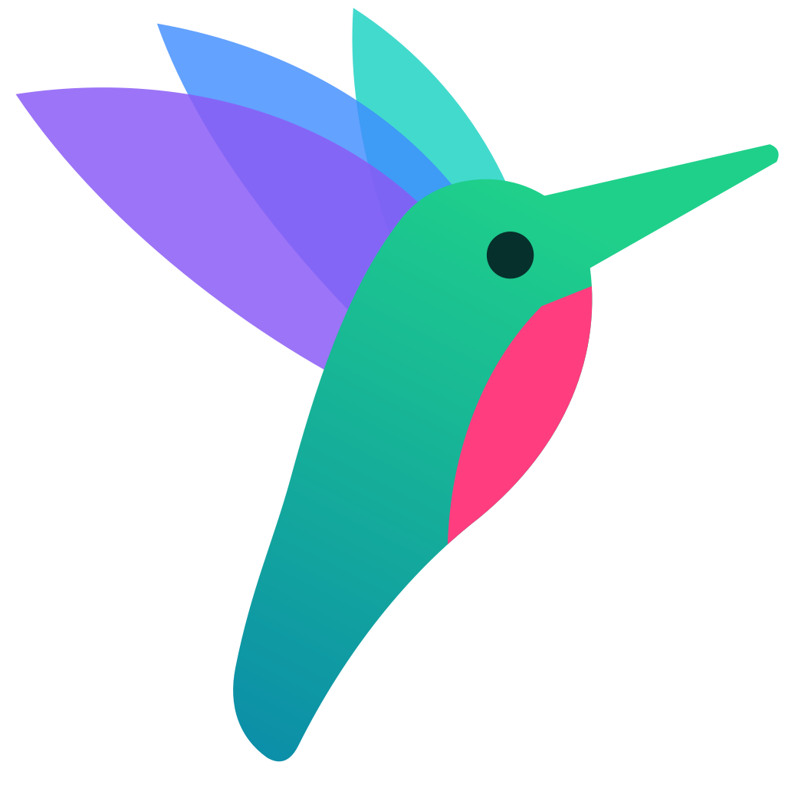

# Colibrii

Colibrii connects a person's devices to each other, for any app. It
introduces two of the person's devices, sets up an encrypted connection
between them, and gets out of the way: the app's data goes from device
to device, and Colibrii never reads it.

It has two halves:

- **The service** ([service/](service/README.md)) keeps each app's
  devices, says which are online, and sets up the tunnels that let a
  device be reached from outside its network. Whoever runs an app runs
  their own instance of it, on their own Cloudflare account and domains.
- **An SDK** in the app enrolls the device, follows the device list,
  dials and listens, and runs the tunnel. There is one in TypeScript
  ([sdk/ts](sdk/ts/README.md)), for desktop apps, programs on a server
  and web pages, and one in Rust ([sdk/rust](sdk/rust/README.md)), for
  desktop apps and programs on a server.

How the two talk is written down in [spec/](spec/README.md), with test
vectors, so an SDK can be written in any language.

People sign in with [Clerk](https://clerk.com). Each app brings its own
Clerk instance, and Colibrii has none of its own.
